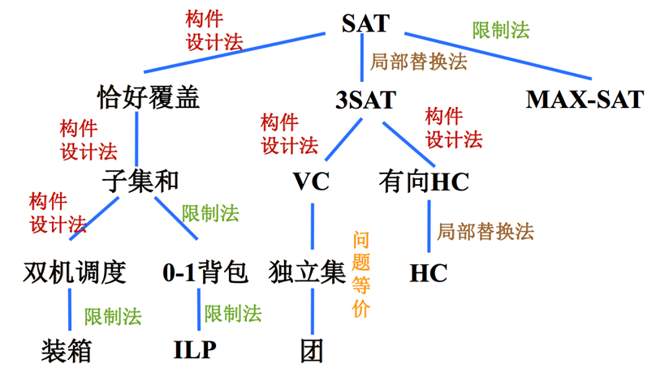
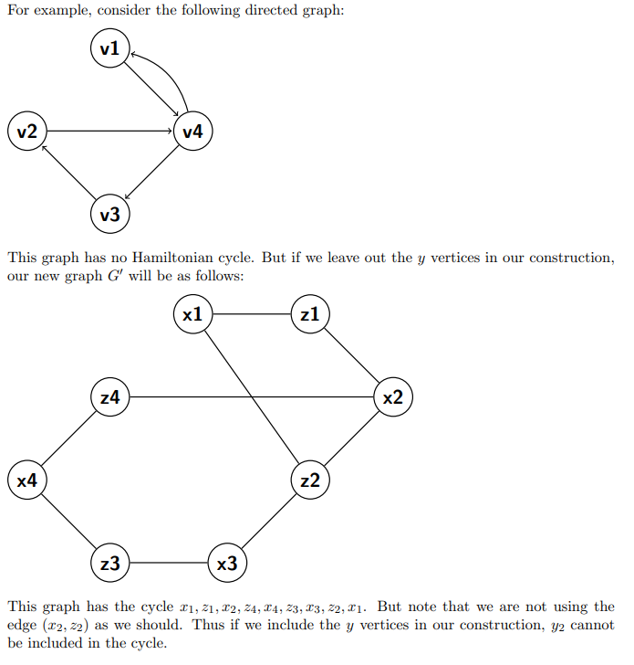
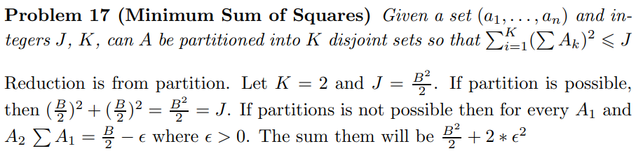

# NP

## NPC 的证明方法

To prove a problem is NPC, we need to:

* show it belongs to NP, by showing a non-deterministic polynomial-time algorithm.
* show it is NP-hard, by reducing from a known NP-hard problem (e.g., SAT, 3-SAT, ...).

## Known NPC Problems

* **[Partition](https://en.wikipedia.org/wiki/Partition_problem)**：把一个数集划分为两个和相等的子集。

  可由 Subset-sum 归约得到，且是 0-1 背包的受限情形。

## Undirected Hamiltonian Cycle

> https://www.ics.uci.edu/~goodrich/teach/cs162/hw/HW8Sols.pdf
>
> Theorem 9.13 in the book.

* 首先，猜测一个顶点顺序，很容易在多项式时间内验证它是否是 HC。

* 其次，从 **Directed Hamiltonian Cycle**（已知可由 3-SAT 归约证明 NP-hard）归约。

  核心是用无向边表示有向边。

  构造：对每个有向图 $G = \langle V, E \rangle$，构造无向图 $G' = \langle V', E' \rangle$，其中：

$$
V' = \{v^{in}, v^{mid}, v^{out} \mid v \in V\} \\
E' = \{(u^{out}, v^{in}) \mid \langle u, v \rangle \in E\} \cup \{(v^{in}, v^{mid}), (v^{mid}, v^{out}) \mid v \in V\}
$$

  现在证明 G 有有向 HC 当且仅当 G' 有无向 HC。

  $\Rightarrow$：容易，把两条对应边连起来即可。

  $\Leftarrow$：注意包含 $v^{mid}$ 的唯一方式是同时包含 $(v^{in}, v^{mid})$ 和 $(v^{mid}, v^{out})$，因此可以找回 G 中对应的有向环。

* 补充：能否去掉 $v^{mid}$，只用 $V' = \{v^{in}, v^{out} \mid v \in V\}$？

  不能，反例如下：

  

## Strongly Independent Set

> https://www.cse.iitd.ac.in/~amitk/SemI-2015/tut11.pdf
>
> https://cs.stackexchange.com/questions/124988/independent-set-poly-reducible-to-strongly-independent-set

以下是 Independent Set 问题的一个版本。给定图 G = (V, E) 和整数 k。对于这个问题，称集合 I ⊆ V 是强独立的，如果对任意两个节点 v, u ∈ I，边 (v, u) 不属于 E，且不存在长度为 2 的路径连接 u 和 v，即不存在节点 w 使得 (u, w) ∈ E 且 (w, v) ∈ E。Strongly Independent Set 问题是判断 G 是否存在大小为 k 的强独立集。证明 Strongly Independent Set 是 NP-complete 的。

**解答**：

* 验证 NP 成员资格同样直接。

* 从 independent set 归约。设 G, k 是 independent set 问题的输入，映射为 Strongly Independent Set 问题的输入：

  对 G 中每条边 e，添加新顶点 $v_e$ 细分它：若 e = (u, v)，则把 e 替换为两条边 (u, $v_e$)、($v_e$, v)。再把所有新顶点 $v_e$ 连成一个团。记新图为 $G'$。

  现在验证：若 S 是 G 的独立集，则同样的顶点集合在 $G'$ 中也是强独立集。

  反过来，设 S 是 $G'$ 的强独立集。首先注意到 k > 1（否则归约平凡正确）。S 不能包含任何新顶点 $v_e$（因为 $G'$ 中任何其他顶点都可以通过长度为 2 的路径从 $v_e$ 到达——$v_e$ 属于团）。因此 S 中的顶点都对应 G 中的顶点。再验证这些顶点在 G 中构成独立集。

## Minimum Sum of Squares

> http://cmcstuff.esyr.org/vmkbotva-r15/5%20%D0%BA%D1%83%D1%80%D1%81/9%20%D0%A1%D0%B5%D0%BC%D0%B5%D1%81%D1%82%D1%80/%D0%A2%D0%B8%D0%B3%D1%80%D1%8B/%D0%A2%D0%B5%D0%BE%D1%80%D0%B8%D1%8F%20%D1%81%D0%BB%D0%BE%D0%B6%D0%BD%D0%BE%D1%81%D1%82%D0%B8%20%D0%BD%D0%B0%20%D0%B0%D0%BD%D0%B3%D0%BB%D0%B8%D0%B9%D1%81%D0%BA%D0%BE%D0%BC.pdf, 17

