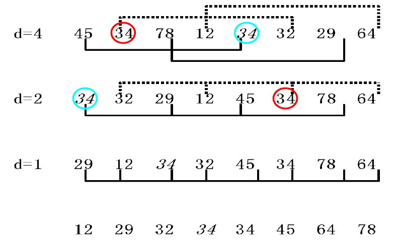

# Inner Sorting

## Concepts

* Record, Key, Sort key, Sequence.
* **Stable/Unstable sorting**: 相同关键码的记录在排序后保持原有相对顺序的排序是稳定的。
* Space Cost: **额外**空间。
* Time Cost: **Best ~ Average ~ Worst**。

## Simple Sorting Algorithms

### Insert Sort

```c++
// naive
void insertsort(int arr[], int n) {
    for (int i = 1; i < n; i++) {
        for (int j = i; j > 0; j--) {
            if (arr[j] < arr[j - 1])
                swap(arr[j], arr[j - 1]);
            else break;
        }
    }
}

// instead of swapping each time, just move back and insert once (need an extra tmp).
void insertsort2(int arr[], int n) {
    for (int i = 1; i < n; i++) {
        int tmp = arr[i];
        int j = i - 1;
        while (j >= 0 && tmp < arr[j]) {
            arr[j + 1] = arr[j];
            j--;
        }
        arr[j + 1] = tmp;
    }
}

// use binary search to accelerate insert
// compare: O(nlogn), move: O(n^2)
void insertsort3(int arr[], int n) {
    for (int i = 1; i < n; i++) {
        int tmp = arr[i];
        int left = 0, right = i - 1;
        while (left <= right) {
            int mid = (left + right) / 2;
            if (tmp < arr[mid]) right = mid - 1;
            else left = mid + 1;
        }
        // left is the first element larger than tmp
        for (int j = i - 1; j >= left; j--)
            arr[j + 1] = arr[j];
        arr[left] = tmp;
    }
}
```

Stable.

Time: $O(n) \sim O(n^2) \sim O(n^2)$

Space: $O(1)$

### Bubble Sort

```c++
// bubble smallest to front
void bubble(int arr[], int n) {
    // each routine makes sure arr[i-1] is the smallest.
    for (int i = 1; i < n; i++)
        for (int j = n - 1; j >= i; j--)
            if (arr[j] < arr[j - 1])
                swap(arr[j], arr[j - 1]);
}

// if no record is swapped in one routine, we can break earlier.
void bubble2(int arr[], int n) {
    bool flag;
    for (int i = 1; i < n; i++) {
        flag = true;
        for (int j = n - 1; j >= i; j--)
            if (arr[j] < arr[j - 1]) {
                swap(arr[j], arr[j - 1]);
                flag = false;
            }
        if (flag) return;
    }
}
```

Stable.

Time1: $O(n^2) \sim O(n^2) \sim O(n^2)$

Time2: $O(n) \sim O(n^2) \sim O(n^2)$

Space: $O(1)$

### Selection Sort

```c++
void selectsort(int arr[], int n) {
    for (int i = 0; i < n - 1; i++) {
        int idx = i; // smallest element's index in [i:]
        for (int j = i + 1; j < n; j++)
            if (arr[j] < arr[idx])
                idx = j;
        swap(arr[i], arr[idx]);
    }
}
```

Unstable.（交换过程会破坏相同关键码记录的原有顺序。`(25, 25', 16, 25'') -> (16, 25', 25, 25'')`）

Space: $O(1)$

Time: $O(n^2) \sim O(n^2) \sim O(n^2)$

改进方向是 **Heap sort**：不再用 $O(n)$ 找最小元素，而是放入堆中，只用 $O(\log n)$。

## Shell Sort (缩小增量排序)

基于插入排序在序列较短且基本有序时的高效性质。

```c++
void shellsort(int arr[], int n) {
    for (int delta = n / 2; delta > 0; delta /= 2)
        for (int j = 0; j < delta; j++)
            insertsort_delta(&arr[j], n - j, delta);
}

void insertsort_delta(int arr[], int n, int delta) {
    for (int i = delta; i < n; i += delta) {
        for (int j = i; j >= delta; j -= delta) {
            if (arr[j] < arr[j - delta])
                swap(arr[j], arr[j - delta]);
            else break;
        }
    }
}
```

Unstable.

不同的增量序列（这里使用 `{n/2, n/4, ..., 1}`）复杂度不同。

Hibbard 序列 $\{2^k - 1, \cdots, 3, 1\}$ 的时间复杂度为 $O(n^{\frac 3 2})$。

Space: $O(1)$



交换次数计算：(1+1+1)+(1+1)+(4) = 9

## Divide-and-Conquer

### Quick Sort (by Hoare)

递归选取一个轴，把较小的记录移到左边、较大的移到右边。

```c++
void quicksort(int arr[], int left, int right) {
    if (left < right) {
        int pivot = partition(arr, left, right);
        quicksort(arr, left, pivot - 1);
        quicksort(arr, pivot + 1, right);
    }
}

int partition(int arr[], int left, int right) {
    int i = left, j = right;
    int tmp = arr[left]; // pivot is selected as the left.
    while (i != j) {
        while ((arr[j] > tmp) && (i < j)) j--; // right to left
        if (i < j) arr[i++] = arr[j];  // swap
        while ((arr[i] <= tmp) && (i < j)) i++; // left to right
        if (i < j) arr[j--] = arr[i];  // swap
    }
    arr[i] = tmp;
    return i;
}

// simplified, sort a[l:r+1]
void quicksort(int a[], int l, int r) {
    if (l < r) {
        int i = l, j = r, x = a[l];
        while (i < j) {
            while (i < j && a[j] >= x) j--;
            if (i < j) a[i++] = a[j];
            while (i < j && a[i] <= x) i++;
            if (i < j) a[j--] = a[i];
        }
        a[i] = x;
        quicksort(a, l, i - 1);
        quicksort(a, i + 1, r);
    }
}
```

Unstable.

Space: $O(1)$

Time: $O(n\log n) \sim O(n\log n) \sim O(n^2)$

当 pivot 总选在近似中间位置时，对应 BST 的高度最小（$\log n$）。

当序列已经有序时，达到最坏时间复杂度 $O(n^2)$。

平均时间复杂度分析（类似随机 BST）：

$$
T(n) = T(i) + T(n-i-1) + cn \\
T(n) = \frac 2 n \sum_{i=0}^{n-1} T(i) + cn \\
nT(n) - (n-1)T(n-1) = 2T(n-1) + cn \\
\frac{T(n)}{n+1} = \frac{T(n-1)}{n} + \frac c n \\
\frac{T(n)}{n+1} \sim O(\log n) \\
T(n) \sim O(n \log n)
$$

#### Variant: 找最小的前 k 个元素 / 第 k 小的元素

两者等价，快排变体可以得到最优**平均时间复杂度** $O(n)$。

（并不要求找到的前 k 个最小元素有序，只保证找到了第 k 小的元素，以及比它小的 k-1 个元素。从而可以避免 k 出现在复杂度公式中，严格达到 $O(n)$。）

`std::nth_element(begin, kth, end)` 实现了这一点。

```c++
void quicksort_k(int arr[], int l, int r, int k) {
    if (l < r) {
        int i = l, j = r, x = arr[l];
        while (i < j) {
            while (i < j && arr[j] >= x) j--;
            if (i < j) arr[i++] = arr[j];
            while (i < j && arr[i] <= x) i++;
            if (i < j) arr[j--] = arr[i];
        }
        arr[i] = x;
        int tmp = i - l + 1; // num of the smaller part of elements
        if (k == tmp) return;
        else if (k < tmp) quicksort_k(arr, l, i - 1, k);
        else quicksort_k(arr, i + 1, r, k - tmp);
    }
}
```

其他解法（这些方法都找到**有序的前 k 个最小元素**，所以复杂度都含有 k）：

* Naive quicksort: $O(n \log n)$
* Naive Heap: $O(n + k \log n)$
* Small Heap: $O(n \log k)$ —— 只维护一个容量为 k 的堆，其余元素与之比较。

  `std::partial_sort(arr, arr+k, arr+N)` 实现了这一点。

  ```c++
  priority_queue<int> heap_k(int arr[], int n, int k) {
      priority_queue<int> q; // maxheap
      for (int i = 0; i < k; i++) q.push(arr[i]); // init
      for (int i = k; i < n; i++) {
          if (arr[i] < q.top()) { // smaller than max
              q.pop();
              q.push(arr[i]);
          }
      }
      return q;
  }
  ```

### Merge Sort

quick sort 关注如何 divide，merge sort 关注如何 merge。

```c++
void mergesort(int arr[], int tmp[], int left, int right) {
    if (left < right) {
        int mid = (left + right) / 2;
        mergesort(arr, tmp, left, mid);
        mergesort(arr, tmp, mid + 1, right);
        merge(arr, tmp, left, right, mid);
    }
}

void merge(int arr[], int tmp[], int left, int right, int mid) {
    for (int i = left; i <= right; i++) tmp[i] = arr[i];
    int i = left, j = mid + 1;
    int idx = left;
    while (i <= mid && j <= right) {
        if (tmp[i] <= tmp[j]) arr[idx++] = tmp[i++];
        else arr[idx++] = tmp[j++];
    }
    while (i <= mid) arr[idx++] = tmp[i++];
    while (j <= right) arr[idx++] = tmp[j++];
}

// simplified, sort [l, r]
int a[maxn], b[maxn];
void mergesort(int* a, int* b, int l, int r) {
    if (l == r) return;
    int m = (l + r) / 2;
    mergesort(a, b, l, m);
    mergesort(a, b, m + 1, r);
    int i = l, j = m + 1, k = l;
    while (i <= m && j <= r) {
        if (a[i] <= a[j]) b[k++] = a[i++];
        else b[k++] = a[j++];
    }
    while (i <= m) b[k++] = a[i++];
    while (j <= r) b[k++] = a[j++];
    for (int i = l; i <= r; i++) a[i] = b[i];
}
```

Stable.

Time: $O(n \log n)$（非常稳定）

Space: $O(n)$（最大）

#### Variants

```bash
# bottom-up merge sort (no recursion)
MergeSort(array, count)
    power_of_two = FloorPowerOfTwo(count)
    scale = count / power_of_two  # 1.0 <= scale < 2.0

    for (length = 16; length < power_of_two; length = length * 2)
        for (merge = 0; merge < power_of_two; merge = merge + length * 2)
            start = merge * scale
            mid = (merge + length) * scale
            end = (merge + length * 2) * scale

            Merge(array, MakeRange(start, mid), MakeRange(mid, end))
```

## Heap Sort

Selection sort 的高级版本。

```c++
void heapsort(int arr[], int n) {
    priority_queue<int> que(arr, arr + n);
    for (int i = 0; i < n; i++) arr[i] = que.top(), que.pop(); // greater to less
}
```

Unstable.

Time: $O(n \log n)$（稳定地）

Space: $O(1)$

## Bin Sort

需要对排序序列进行一定的假设限制。不通过**比较 & 交换**，而通过**收集 & 分配**排序。

### Bucket Sort (Counting Sort)

```c++
// assume arr[]'s range in [0, m)
void bucketsort(int arr[], int n, int m) {
    int* tmp = new int[n]; // copy of arr
    int* cnt = new int[m]; // m buckets
    int i;
    for (i = 0; i < n; i++) tmp[i] = arr[i];
    for (i = 0; i < m; i++) cnt[i] = 0;
    // fill each bucket
    for (i = 0; i < n; i++) cnt[arr[i]]++;
    // calculate position (cumulative sum)
    for (i = 1; i < m; i++) cnt[i] += cnt[i - 1];
    // collect in reverse order to keep stability.
    for (i = n - 1; i >= 0; i--) arr[--cnt[tmp[i]]] = tmp[i];
}
```

Stable（倒序收集时）。

Time: $O(m + n)$

Space: $O(m + n)$

**当 m 相对于 n 很小时适用。**

桶排序其实是计数排序的推广，**上面的实现实际上是计数排序**。

> The particular distinction for bucket sort is that it uses a hash function to partition the keys of the input array, so that multiple keys may hash to the same bucket.
>
> 桶排序使用更加复杂的桶：每个桶划分一个范围，桶内部可能需要调用其他排序算法，最后收集所有桶。计数排序的桶十分简单。基数排序使用多次计数排序。

### Radix Sort

当 m 很大时桶排序的改进版。**Divide-and-Conquer.**

* MSD: most significant digit first（人类更常用，**4**56 > **1**23）
* LSD: least significant digit first（计算机更常用，**456** > **123**）

#### Implementation: Array-based

```c++
// assume there are *d* digits in key, each digit in [0, r).
// for integers, r=10, d=max([len(str(i)) for i in arr])
void radixsort(int arr[], int n, int d, int r) {
    int* tmp = new int[n];
    int* cnt = new int[r];
    int i, j, k;
    int radix = 1;
    // LSD, call Bucket sort d times.
    for (i = 1; i <= d; i++) {
        for (j = 0; j < r; j++) cnt[j] = 0;
        for (j = 0; j < n; j++) {
            k = (arr[j] / radix) % r;
            cnt[k]++;
        }
        for (j = 1; j < r; j++) cnt[j] += cnt[j - 1];
        for (j = n - 1; j >= 0; j--) {
            k = (arr[j] / radix) % r;
            tmp[--cnt[k]] = arr[j];
        }
        // copy back to arr
        for (j = 0; j < n; j++) arr[j] = tmp[j];
        radix *= r;
    }
}
```

Stable.

Time: $O(d \cdot (r + n)) \sim O(d \cdot n)$

但由于 $d \ge \log_r n$，$O(d \cdot n) \sim O(n \log n)$。

Space: $O(r + n)$

#### Implementation: LinkedList-based

避免在 tmp 和 arr 之间来回复制。

```c++
struct node {
    int key;
    int next;
};
struct que {
    int head;
    int tail;
};

void radixsort(int arr[], int n, int d, int r) {
    int i;
    int first = 0;
    que *q = new que[r];
    for (i = 0; i < n - 1; i++) arr[i].next = i + 1;
    arr[n - 1].next = -1;
    for (i = 0; i < d; i++) {
        distribute(arr, first, i, r, q);
        collect(arr, first, i, r, q);
    }
    delete [] q;
}

void distribute(int arr[], int first, int i, int r, que* q) {
    for (j = 0; j < r; j++) q[j].head = -1;
    while (first != -1) {
        int k = arr[first].key;
        for (int a = 0; a < i; a++) k /= r;
        k %= r;
        if (q[k].head == -1) q[k].head = first;
        else arr[q[k].tail].next = first;
        q[k].tail = first;
        first = arr[first].next;
    }
}

void collect(int arr[], int& first, int i, int r, que* q) {
    int last, k = 0;
    while (q[k].head == -1) k++;
    first = q[k].head;
    last = q[k].tail;
    while (k < r - 1) {
        k++;
        while (k < r - 1 && q[k].head == -1) k++;
        if (q[k].head != -1) {
            arr[last].next = q[k].head;
            last = q[k].tail;
        }
    }
    arr[last].next = -1;
}
```

#### String Radix Sort

```c++
vector<string> ans;
void radixsort(vector<string>& s, int k = 0) {
    if (s.empty()) return;
    vector<string> bucket[26];
    for (int i = 0; i < s.size(); ++i) {
        if (s[i].length() == k) {
            ans.push_back(s[i]);
            continue;
        }
        int index = s[i][k] - 'a';
        bucket[index].push_back(s[i]);
    }
    for (int i = 0; i < 26; ++i) radixsort(bucket[i], k + 1);
}
```

Time Complexity: $O(\sum_i s_i)$

字母字符串排序有一个性质：从第一个字母开始排序，无论字符串多长，后面的桶排序都不会改变前面桶排序得到的次序。

### Index Sort

避免移动记录本身，而对索引/地址排序。

* Where am I going? `res[idx1[i]] = arr[i]`
* Where am I from? `arr[idx2[i]] = res[i]`

二选一即可，下面的代码使用 idx2：

```c++
template<class record>
void indexsort(record arr[], int idx[], int n) {
    for (int i = 0; i < n; i++) idx[i] = i;
    // simple insert sort kernel to sort only idx.
    for (int i = 1; i < n; i++) {
        for (int j = i; j > 0; j--) {
            if (arr[idx[j]] < arr[idx[j - 1]])
                swap(idx[j], idx[j - 1]);
            else break;
        }
    }
    adjust(arr, idx, n); // modify records
}

// time: O(n), space: **O(1)**
template<class record>
void adjust(record arr[], int idx[], int n) {
    record tmp;
    for (int i = 0; i < n; i++) {
        tmp = arr[i];
        int j = i;
        while (idx[j] != i) {
            arr[j] = arr[idx[j]];
            // swap(idx[j], j);
            int k = idx[j];
            idx[j] = j;
            j = k;
        }
        arr[j] = tmp;
        idx[j] = j;
    }
}
```

关键在于 adjust 仅使用 $O(1)$ 额外空间。

## Summary

**排序算法的下界分析：判定树。**

有 n 个记录，生成的判定树有 $n!$ 个叶节点，树深为 $O(\lg(n!)) \sim O(n \log n)$。

最坏情况下比较次数为根到叶的最长距离，即树深。

最好情况下比较次数为根到叶的最短距离，即 $n - 1$。
