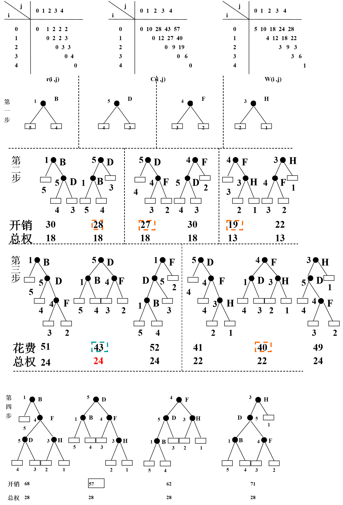

# Advanced Data Structure

## 多维数组

* 数组的存储与定位

  行优先：C；列优先：Fortran。

  下标计算：

$$
loc(A[j_0, \cdots, j_{n-1}]) = loc(A[0, \cdots, 0]) + size \cdot \left[ \sum_{i=0}^{n-2} \left( j_i \prod_{k=i+1}^{n-1} d_k \right) + j_{n-1} \right]
$$

* 特殊矩阵的**压缩存储**

  * 对称矩阵
  * 对角矩阵：只需存储 N 个对角元。
  * 上/下三角矩阵：$N(N+1)/2 + 1$
  * 稀疏矩阵：三元组表、十字链表

## Generalized Lists（广义表，Multi-list）

线性表的拓展：线性表内的元素均为同一类型，而广义表的每个元素可以是子表（sub-list）或原子（atom）。

**广义表深度**：嵌套的最多子表数，即所有元素化解为原子后的括号层数。

* HEAD：广义表中第一个**(!)元素(!)**。
* TAIL：广义表中**第一个元素以外的元素构成的(!)广义表(!)**。

  eg. `L = ((a,b),c), c = H(T(L)), b = H(T(H(L)))`

* 线性表（sequential list）：等价于一棵深度为 1 的树。
* 纯表（pure list）：从根节点到任意一个叶节点只有一条路径，即任何元素只出现一次。等价于一棵树。
* 可重入表 / 再入表：元素可以重复，但不包含回路。等价于 DAG。深度定义同上。
* 循环表 / 递归表：可以包含回路。等价于图。无法计算深度。

  eg. (L1:(L2:(L1, a)))

  ```bash
             *
            /
           L1
          ^ \
          |__L2
              \
               a
  ```

## 字典树 Trie

* 英文字母 Trie 树

  用于多子串的字符串匹配问题。**Trie 树往往不平衡。**

* 二叉 Trie 树（PAT-Tree，Patricia）

## 二叉排序树变体 BST Variants

### 最佳 BST

* N 个关键码的集合构成 $N!$ 种排列。

  **其中只有 $Catalan(N) = \frac{C_{2n}^n}{n+1}$ 个排列可以构成 BST。**

* BST 查找效率的测量

  对 BST 扩充，则外部节点即查找失败的位置。

  **最佳 BST**：根据用户历史访问频率，可以计算 ASL 最小的 BST。

#### 构造最佳 BST 的方法

* 节点检索等概率

  p 为内部节点，共 n 个；q 为外部节点，共 n+1 个。

$$
\frac{p_i}{W} = \frac{q_j}{W} = \frac 1 {2n+1} \\
ASL(n) = \frac 1 {2n+1} \left( \sum_{i=1}^{n} (H(p_i) + 1) + \sum_{j=0}^{n} H(q_j) \right) \\
= \frac 1 {2n+1} (I + n + E) \\
= \frac{2I + 3n}{2n+1}
$$

  故在 n 已知时，构造 I 最短的 BST 即可，即类似完全二叉树的形状。

* **节点检索不等概率**

  动态规划构造，任何子树都是最佳 BST。

  `t(i, j)`: 包含内部节点 i+1 到 j 的子树
  `C(i, j)`: 节点 i+1 到 j 的查询代价
  `W(i, j)`: 权值总和，i+1 到 j 的内部节点权重加上 i 到 j 的外部节点权重

  递推公式：

  `C(i, j) = W(i, j) + min{C(i, k-1) + C(k, j)}, for k in [i, j]`



### 平衡 BST（AVL）

#### 平衡因子

$$
bf(x) = height(rightchild(x)) - height(leftchild(x))
$$

**AVL 树的所有节点 bf 值只能是 $\{0, 1, -1\}$。**

$ASL = O(\lg n)$。

#### 性质

* 空二叉树是 AVL 树。
* T 为 AVL 树，则左右子树 L、R 也是 AVL 树，且 $|h_R - h_L| \le 1$。
* T 的高度为 $O(\lg n)$。

#### AVL 插入

```bash
# TL;DR
先根据 BST 规则找到插入位置并插入，回溯两层父节点检查 bf。
* 仍平衡：结束
* 失衡：
    * LL、RR 型：单旋转
    * LR、RL 型：双旋转（提升最尾节点）

# 双旋转是最简单的！排成一排，提升尾节点就平衡啦！
```

先根据 BST 规则找到插入位置。

* 插入后发生偏重，但仍然平衡。
* 插入前有偏重，插入后平衡。
* 插入后失衡，进行平衡调整。

  从新插入的节点 u 向上查找到第一个不平衡的祖先 A，设 A 指向 u 的路径上第一个子节点为 B，第二个子节点为 C。

  * 单旋转

    * LL：A 的 L 的 L 导致失衡，$bf(A) = -2$

    ```bash
    # ===== init =====
              A(-2)
              /    \
           B(-1)   [h]T2
           /    \
    *T0[h+1]* [h]T1
    
    # ===== rotate A,B =====
             B(0)
             /    \
        T0[h+1]    A(0)
                   /    \
              T1[h]    [h]T2
    ```

    * RR：A 的 R 的 R 导致失衡，$bf(A) = 2$（镜像）。

  * 双旋转

    最终效果：先把四个子树排成一行，再把 C 挪到最上面，AB 放中间。

    * LR：A 的 L 的 R 导致失衡，$bf(A) = -2$

    ```bash
    # ===== init =====
                A(-2)
               /     \
            B(1)     [h]E
           /    \
        D[h]    (-1)C
                /   \
            *F[h]*  [h-1]G
    
    # ===== rotate B,C =====
                A(-2)
               /     \
            C(-2)    [h]E
           /    \
        B(0)    [h-1]G
       /   \
    D[h]   [h]F
    
    # ===== rotate A,C =====
                 C(0)
               /      \
              /        \
            B(0)        (1)A
           /    \       /   \
        D[h]    [h]F  G[h-1] [h]E
    ```

    * RL：A 的 R 的 L 导致失衡，$bf(A) = 2$（镜像）。

#### AVL 删除

```bash
# TL;DR
如果是中间节点，先与前驱/后继交换位置，删除之，再向上两层检查父节点 T 的 bf。
* 平衡：
    * 高度不变：结束
    * 高度减一：递归向上，检查 bf
* 失衡：
    设父节点较高子树 R，讨论其 bf：
    * bf(R)==0：单旋转 RT，结束
    * bf(R) 与 bf(T) 同号：单旋转 RT，递归向上
    * bf(R) 与 bf(T) 异号：双旋转 LR、R；LR、T；递归向上
```

先与后继（右子树最小值）或前驱（左子树最大值）交换再进行删除。

设被删节点的父节点为 root，可能需要向上回溯（modified = True）。

* `bf(root) = 0`

  左子树/右子树被缩短，bf = 1/-1，modified = False。

* `bf(root) != 0`，且较高子树被缩短

  bf = 0，modified = True（树高减一），故回溯向上检查父节点 bf。

* `bf(root) != 0`，且较低子树被缩短

  开始时 bf(root) = 1/-1，不妨设较高子树为 right，则 bf(root) = 1。

  * `bf(right) = 0`

    单旋转 root、right；modified = False。

    ```bash
    # ===== init =====
            T(1)        :[h+2]
            /   \
          [h]   (0)R
                /  \
              [h]   [h]
    # ===== delete =====
            T(2)        :[h+2]
            /   \
        [h-1]   (0)R
                /  \
              [h]   [h]
    # ===== rotate T,R =====
            R(-1)       :[h+2]
            /   \
         T(1)    [h]
          /  \
       [h-1]  [h]
    ```

  * `bf(right) == bf(root)`

    单旋转 root、right；modified = True（树高减一），回溯。

    ```bash
    # ===== init =====
            T(1)        :[h+2]
            /   \
         [h]    (1)R
                /  \
            [h-1]   [h]
    
    # ===== delete =====
            T(2)        :[h+2]
            /   \
        [h-1]   (1)R
                /  \
            [h-1]   [h]
    
    # ===== rotate T,R =====
            R(0)        :[h+1], backtrace
            /   \
         T(0)    [h]
         /   \
     [h-1]   [h-1]
    ```

  * `bf(right) != bf(root)`

    双旋转 RL、R；root、RL；modified = True（树高减一），回溯。

    ```bash
    ### based on condition of LR (left of right):
    ## bf(LR)=0
    # ===== init =====
              T(1)            :[h+2]
             /    \
          [h]      (-1)R
                  /   \
              LR(0)    [h-1]
              /   \
          [h-1]   [h-1]
    # ===== delete =====
              T(2)
             /    \
        [h-1]      (-1)R
                  /   \
              LR(0)    [h-1]
              /   \
          [h-1]   [h-1]
    
    # ===== double rotate =====
                 LR(0)          :[h+1], backtrace
               /       \
              /          \
            T(0)         (0)R
           /    \        /   \
        [h-1]   [h-1] [h-1]  [h-1]
    
    ## bf(LR)=1
    # ===== init =====
              T(1)
             /    \
          [h]      (-1)R
                  /   \
              LR(1)    [h-1]
              /   \
          [h-2]   [h-1]
    # ===== delete =====
              T(2)
             /    \
        [h-1]      (-1)R
                  /   \
              LR(1)    [h-1]
              /   \
          [h-2]   [h-1]
    # ===== double rotate =====
                 LR(0)
               /       \
              /          \
            T(-1)        (0)R
           /    \        /   \
        [h-1]   [h-2] [h-1]  [h-1]
    
    ## bf(LR)=-1
    # ===== init =====
              T(1)
             /    \
          [h]      (-1)R
                  /   \
              LR(-1)   [h-1]
              /   \
          [h-1]   [h-2]
    # ===== delete =====
              T(2)
             /    \
        [h-1]      (-1)R
                  /   \
              LR(1)    [h-1]
              /   \
          [h-1]   [h-2]
    # ===== double rotate =====
                 LR(0)
               /       \
              /          \
            T(0)         (1)R
           /    \        /   \
        [h-1]   [h-1] [h-2]  [h-1]
    ```

### 伸展树（Splay）

动态自组织的数据结构：检索频繁的记录离根节点更近。

Splay 规则保证访问代价较低，不保证平衡。

#### 展开 Splaying

访问节点 X 时，进行展开操作：

* 插入/检索 X：**把 X 移动到 BST 根节点。**
* 删除 X：**先与前驱/后继交换，删除后，把此时 X 的父节点移动到 BST 根节点。**

具体而言：

* X 是根节点的直接子节点：单旋转。
* X 离根节点两层及以上：一系列双旋转 + 可能的单旋转。
  * 一字型旋转：LL/RR，同构调整。仅仅把 X 向上提升。

    **快速做法：双重单旋转**

    ```bash
    # ===== insert C =====
            A
           / \
          B   D
         / \
        C   E
    # ===== rotate AB =====
            B
           / \
          C   A
             / \
            E   D
    # ===== rotate BC =====
            C
             \
              B
               \
                A
               / \
              E   D
    ```

    **注意！Splay 默认自顶向下地进行旋转：**

    ```bash
    # ===== insert 6 =====
        8
       /
      7
     /
    6
    # ===== rotate 8,7 =====
        7
       / \
      6   8
    
    # ===== rotate 7,6 =====
       6
        \
         7
          \
           8
    
    ## another method, **Don't use this!!!**
    # ===== rotate 6,7 =====
       8
      /
     6
      \
       7
    # ===== rotate 8,6 =====
       6
        \
         8
        /
       7
    ```

  * 之字形旋转：LR/RL，异构调整。提升 X 的同时子树高度减一，趋近平衡。

    快速做法：**这就是双旋转，可以直接排一排、提升尾。**

#### 效率分析

* 一次访问操作的代价：$O(n)$，不保证单个操作高效。
* m 次访问操作的总代价：$O(m \lg n)$，**每次操作平均代价 $O(\lg n)$**，保证多个操作平均高效。
